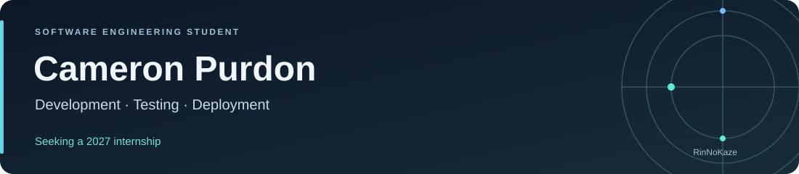

  

# Hi, I'm Cameron

**Software Engineering student at Belgium Campus iTversity · South Africa**

I'm studying towards a Bachelor of Computing, specialising in Software Engineering, with interests in web development, databases and application security.

**Seeking a 2027 internship or workplace placement** where I can contribute to a software team and develop my engineering skills.

## Featured work

### CivicConnect

A C# and ASP.NET Core service request management application built with a team, using PostgreSQL.

- Contributed requester, staff and management screens and portal integration.
- Observed five participant usability sessions and recorded the findings.

[Source code and setup](https://github.com/Michael-Ellis819/Virtual_Group_K_SEN381_Project) · [My merged integration PR](https://github.com/Michael-Ellis819/Virtual_Group_K_SEN381_Project/pull/22)

### GradConnect

A student recruitment platform developed as an academic team project.

My contributions:

- Deployed the complete application.
- Diagnosed and fixed defects in the web crawler and messaging system.
- Took primary responsibility for application testing.

[Read about my GradConnect contribution →](projects/gradconnect.md)

### BC WildWatch

An academic team project for wildlife incident reporting and management using Microsoft Power Platform.

- Presented the notification component, explaining email and Microsoft Teams alerts and the Power Automate flow.

[Read about BC WildWatch →](projects/bc-wildwatch.md)

## Technologies I've worked with

| Area | Technologies |
| :--- | :--- |
| Programming and web fundamentals | C#, JavaScript, SQL, HTML, CSS |
| Academic web project technologies | ASP.NET Core, Razor, Node.js, Express, React, TypeScript, EJS |
| Development tools and databases | Visual Studio, GitHub, SQL Server, PostgreSQL, MongoDB, Mongoose |
| Microsoft platforms | Power Apps, SharePoint, Power Automate, Microsoft Teams |
| Additional language studied | Delphi / Object Pascal |

Outside computing, I enjoy nature and learning languages.
